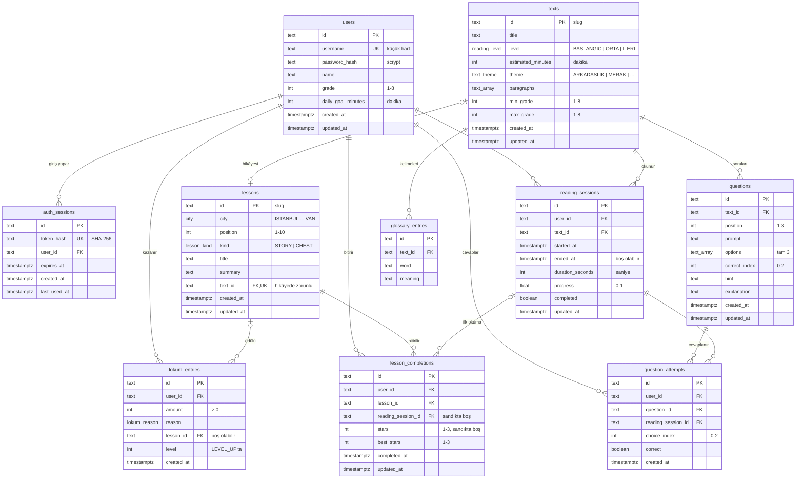

# Veritabanı

Okumatik backend'i PostgreSQL kullanır; şema [Prisma](../prisma/schema.prisma) ile tanımlanır ve
[migration](../prisma/migrations/)'larla oluşturulur. Bu belge tabloları, ilişkileri ve rapor
görünümlerini (view) anlatır. Bağlantı bilgileri ve araçlar için kök
[README](../../README.md#veritabanını-görüntüleme)'ye bakın.

Kullanıcılar 7-14 yaş arası çocuklardır; kişisel veri en aza indirilir. E-posta, doğum tarihi,
telefon gibi alanlar bilinçli olarak yoktur.

## Kurallar

- **İsimlendirme:** PostgreSQL'de tablo ve kolon adları `snake_case`, Prisma'da (kodda)
  `camelCase`'tir. Ör. Prisma'daki `ReadingSession.startedAt` → `reading_sessions.started_at`.
- **Index ve kısıt adları** `<tablo>_<kolonlar>_<tür>` biçimindedir: `_pkey` birincil anahtar,
  `_key` tekil (unique) index, `_idx` index, `_fkey` yabancı anahtar, `_check` CHECK kısıtı.
  Ör. `reading_sessions_user_id_started_at_idx`.
- **Zamanlar** `timestamptz(3)` (saat dilimli, milisaniye hassasiyetinde) saklanır. "Gün" hesabı
  (günlük hedef, `v_daily_reading`) Türkiye saatine (`Europe/Istanbul`) göredir.
- **Açıklamalar:** Her tablo ve kolonun Türkçe açıklaması hem `schema.prisma`'da (`///`) hem
  veritabanında (`COMMENT ON`) vardır; DBeaver/TablePlus'ta "Comment" olarak, psql'de `\d+ users`
  ile görünür.
- **Kimlikler:** Kullanıcı, oturum, soru ve kayıt kimlikleri `cuid` (ör.
  `cmg8x1k2p0000abcd1234efgh`); metin ve ders kimlikleri okunabilir slug'dır (ör. `minik-serce`,
  `istanbul-03-minik-serce`). Seed'in oluşturduğu örnek okuma kayıtlarının kimliği
  `seed-<kullanıcı>-NN` biçimindedir.
- **Türetilen değerler saklanmaz:** Seviye, bulunulan şehir, seri ve lokum bakiyesi hiçbir
  kolonda yoktur; tamamlanan derslerden, okumalardan ve lokum defterinden hesaplanır
  ([Oyun kuralları](#oyun-kuralları)).

## İlişkiler



- Bir kullanıcının birden çok **giriş oturumu** (farklı cihazlar) ve birden çok **okuma kaydı**
  olabilir.
- Bir metin birçok kez okunabilir; her açılış yeni bir `reading_sessions` satırıdır.
- Her hikâye dersinin bir metni vardır; bir metin en fazla bir derse aittir. Yolculukta olmayan
  metinler yalnızca kitaplıkta okunur.
- Yabancı anahtarların çoğu `ON DELETE CASCADE`'dir: kullanıcı silinince oturumları, okumaları,
  cevapları, ders tamamlamaları ve lokumları; metin silinince okumaları, soruları ve kelimeleri de
  silinir. İstisnalar `ON DELETE SET NULL`'dur: `lessons.text_id`,
  `lesson_completions.reading_session_id` ve `lokum_entries.lesson_id` (lokum defteri ders
  silinse de kaybolmaz).

## Tablolar

### `users` — öğrenciler

| Kolon                | Açıklama                                                              |
| -------------------- | --------------------------------------------------------------------- |
| `username`           | Giriş adı, tekil; her zaman küçük harf (ör. `ayse.k`)                 |
| `password_hash`      | Şifrenin scrypt hash'i; şifrenin kendisi saklanmaz                    |
| `name`               | Ekranda gösterilen ad (ör. `Ayşe`)                                    |
| `grade`              | Sınıf, 1-8. Kullanıcıya hangi metinlerin listeleneceğini belirler     |
| `daily_goal_minutes` | Günlük okuma hedefi (dakika), varsayılan 10                           |
| `updated_at`         | Son güncellenme; Prisma doldurur (SQL ile yapılan değişiklikte değil) |

Kısıtlar: `users_grade_range_check` (1-8), `users_daily_goal_minutes_positive_check` (> 0),
`users_username_lowercase_check` (küçük harf).

### `auth_sessions` — giriş oturumları

Kullanıcı giriş yaptığında oluşur, çıkışta veya süresi dolunca silinir. **Okuma oturumu
değildir.** İstemciye giden token saklanmaz; yalnızca SHA-256 hash'i (`token_hash`) tutulur,
yani veritabanını gören biri token'ı kullanamaz.

| Kolon          | Açıklama                                                          |
| -------------- | ----------------------------------------------------------------- |
| `token_hash`   | Token'ın SHA-256 hash'i (64 karakter hex), tekil                  |
| `user_id`      | Oturumun sahibi (`users.id`)                                      |
| `expires_at`   | Geçerlilik sonu; oturum kullanıldıkça 30 gün ileri kayar          |
| `last_used_at` | Son kullanım (her istekte değil, en fazla 5 dakikada bir yazılır) |

`last_used_at` her kullanımda güncellendiği için bu tabloda ayrıca `updated_at` yoktur.

### `texts` — okuma metinleri

| Kolon                     | Açıklama                                                                            |
| ------------------------- | ----------------------------------------------------------------------------------- |
| `id`                      | Okunabilir slug (ör. `minik-serce`)                                                 |
| `level`                   | `reading_level` enum'u: `BASLANGIC`, `ORTA`, `ILERI`                                |
| `estimated_minutes`       | Tahmini okuma süresi (dakika)                                                       |
| `theme`                   | `text_theme` enum'u: hikâyenin teması (ör. `ARKADASLIK`)                            |
| `paragraphs`              | Paragraflar, sırasıyla (`text[]`)                                                   |
| `min_grade` / `max_grade` | Metnin uygun olduğu sınıf aralığı; kullanıcının `grade`'i bu aralıktaysa listelenir |

API seviyeyi sayı olarak döner (`BASLANGIC`=1, `ORTA`=2, `ILERI`=3). Dönüşüm yalnızca
[`src/lib/reading-level.ts`](../src/lib/reading-level.ts)'te yapılır. Enum değerlerinin sırası
seviye sırasıdır; `ORDER BY level` kolaydan zora sıralar.

Tema haritada ("Arkadaşlık · 2 dk"), okuma ekranında ve kitaplıkta etiket olarak görünür. Değerler:
`ARKADASLIK`, `MERAK`, `KESIF`, `PAYLASMAK`, `CESARET`, `YARDIMLASMA`, `SABIR`, `DOGA`, `AILE`,
`HATIRALAR`, `SORUMLULUK`, `IYILIK`. API Türkçe adını döner (ör. `"Arkadaşlık"`); dönüşüm yalnızca
[`src/lib/text-theme.ts`](../src/lib/text-theme.ts)'te yapılır. Her hikâyenin teması hikâye
okunarak seçilir ve seed verisinde (`prisma/seed-data/*.ts`) yazılıdır. Kolonu ekleyen
`*_text_theme` migration'ı mevcut metinleri aynı eşlemeyle doldurur; `test/seed-data.test.ts`
ikisinin aynı kaldığını denetler.

Kısıtlar: `texts_estimated_minutes_positive_check` (> 0), `texts_grade_range_check`
(1 ≤ `min_grade` ≤ `max_grade` ≤ 8).

### `reading_sessions` — okuma kayıtları

Kullanıcı bir metni açtığında oluşur (`POST /reading-sessions`); okuma sırasında ilerleme ve
süre güncellenir (`PATCH /reading-sessions/:id`).

| Kolon              | Açıklama                                                                           |
| ------------------ | ---------------------------------------------------------------------------------- |
| `started_at`       | Okumanın başladığı an; günlük hedefte bu anın günü (Türkiye saati) sayılır         |
| `ended_at`         | Son ilerleme kaydının anı; metin açılıp hiç kaydedilmediyse boş                    |
| `duration_seconds` | Toplam okuma süresi (saniye). Sunucu, gerçekte geçen süreden fazlasını kabul etmez |
| `progress`         | 0-1 arası oran (0.6 = %60). Geri gitmez; `completed` ise 1'dir                     |
| `completed`        | Metin sonuna kadar okundu mu; bir kez `true` olunca geri dönmez                    |

Kısıtlar: `reading_sessions_progress_range_check` (0-1),
`reading_sessions_duration_seconds_non_negative_check` (≥ 0). Index:
`reading_sessions_user_id_started_at_idx` (kullanıcının günlük toplamı ve son okumaları için).

### `lessons` — yolculuk dersleri

Yoldaki düğümler: 6 şehir × 10 ders. 5. ve 10. ders **sandık** (`CHEST`), diğerleri **hikâye**
(`STORY`: metni oku + 3 soru). İçerik `prisma/seed-data/<şehir>.ts` dosyalarından gelir.
Yolculuk tüm sınıflar için ortaktır; metinleri 1-8. sınıfların hepsine açıktır ve tahmini
süreleri tek bir kuralla (yaklaşık 45 kelime ≈ 1 dakika) hesaplanır. İçerik kuralları (4-6
paragraf, 90-180 kelime, 3 soru × 3 şık, metinde geçen 2-3 kelime anlamı, tekil kimlikler)
`test/seed-data.test.ts` ile denetlenir.

| Kolon      | Açıklama                                                                          |
| ---------- | --------------------------------------------------------------------------------- |
| `id`       | Okunabilir slug: `<şehir>-<sıra>-<ad>`, ör. `istanbul-03-minik-serce`             |
| `city`     | `city` enum'u; değerlerin sırası yolculuk sırasıdır (`ORDER BY city` doğru)       |
| `position` | Şehir içindeki sıra, 1-10 (`order` SQL anahtar kelimesi olduğu için kullanılmadı) |
| `kind`     | `lesson_kind` enum'u: `STORY` veya `CHEST`                                        |
| `summary`  | Ders kartında görünen tek cümle                                                   |
| `text_id`  | Hikâyenin metni; hikâyede zorunlu, sandıkta boş. Tekil                            |

API şehri küçük harfli kimlik olarak döner (`ISTANBUL` → `istanbul`); dönüşüm yalnızca
[`src/lib/city.ts`](../src/lib/city.ts)'te yapılır.

Kısıtlar: `lessons_city_position_key` (şehirde her sıra bir kez), `lessons_text_id_key`,
`lessons_position_range_check` (1-10), `lessons_story_text_check` (hikâyenin metni var, sandığın yok).

### `questions` — anlama soruları

| Kolon           | Açıklama                                            |
| --------------- | --------------------------------------------------- |
| `text_id`       | Sorunun metni                                       |
| `position`      | Metindeki sıra, 1-3                                 |
| `options`       | Tam 3 şık (`text[]`), ekrandaki sırasıyla (A, B, C) |
| `correct_index` | Doğru şık (0-2). **İstemciye gönderilmez**          |
| `hint`          | Yanlış cevaptan sonra gösterilen ipucu              |
| `explanation`   | Doğru cevaptan sonra gösterilen açıklama            |

Kısıtlar: `questions_text_id_position_key`, `questions_position_range_check` (1-3),
`questions_options_count_check` (tam 3 şık), `questions_correct_index_range_check` (0-2).

### `glossary_entries` — kelime anlamları

Okurken mor renkli kelimeye dokununca Pırıl'ın söylediği anlam. `word` metinde yazıldığı gibidir
(ör. `yuvası`). Tekil: `glossary_entries_text_id_word_key`.

### `question_attempts` — cevaplar

Şıkka her dokunuş bir satırdır (`POST /lessons/:id/answers`). Dersin ilk tamamlanışında yıldızı ve
lokumu, kullanıcının her soruya **hangi okumada olursa olsun** verdiği ilk cevap belirler: yanlış
cevaptan sonra sorulardan çıkıp hikâyeyi yeniden okumak o soruyu "ilk denemede doğru" yapmaz.
Tekrar oynamada (ders bitmişken) yıldız yalnızca o okumanın (`reading_session_id`) ilk cevaplarına
bakar. Index'ler: `question_attempts_reading_session_id_question_id_idx`,
`question_attempts_user_id_idx`.

### `lesson_completions` — bitirilen dersler

Kullanıcı başına ders başına tek satır (`lesson_completions_user_id_lesson_id_key`). İlk
tamamlama satırı oluşturur ve ödülleri yazar; tekrar oynamak yalnızca `best_stars`'ı yükseltebilir.

| Kolon                | Açıklama                                             |
| -------------------- | ---------------------------------------------------- |
| `reading_session_id` | İlk tamamlamadaki okuma; sandıkta boş                |
| `stars`              | İlk tamamlamadaki yıldız (1-3); sandıkta boş         |
| `best_stars`         | Tekrarlar dahil en iyi yıldız; `stars`'tan az olamaz |
| `completed_at`       | Dersin ilk bitirildiği an                            |

Kısıtlar: `lesson_completions_stars_range_check`, `lesson_completions_best_stars_check`.

### `lokum_entries` — lokum defteri

Her kazanç bir satırdır; **bakiye = `sum(amount)`** (users'ta bakiye kolonu yok). Bir dersin ilk
tamamlanışı aynı işlemde (transaction) şu satırları yazar: ders (`LESSON`) ya da sandık
(`CHEST`), kazanılan her seviye için `LEVEL_UP` (`level` = ulaşılan seviye) ve yeni şehir açıldıysa
`CITY_UNLOCK`. Hepsinde `lesson_id` ödülü doğuran derstir.

Kısıtlar: `lokum_entries_amount_positive_check` (> 0), `lokum_entries_level_check` (`level`
yalnızca `LEVEL_UP`'ta, 2-30).

## Oyun kuralları

Kaynak: [`docs/tasarim/README.md`](../../docs/tasarim/README.md) "Oyun kuralları (v1)". Kod:
[`src/lib/journey.ts`](../src/lib/journey.ts) (saf fonksiyonlar, birim testli).

- **Açılma:** İstanbul'un ilk dersi hep açıktır; diğer her ders, yolculuk sırasında (şehir sırası,
  sonra `position`) bir önceki ders bitince açılır. Kilitli dersin metni kitaplıkta görünmez,
  açılamaz ve okunmaya başlanamaz (403).
- **Seviye** = 1 + ⌊bitirilen ders / 2⌋, en fazla 30. **Şehir** seviyeden gelir: 1-5 İstanbul,
  6-10 İzmir, 11-15 Efes, 16-20 Antalya, 21-25 Kapadokya, 26-30 Van. Bir şehrin 10. dersi bitince
  seviye bir sonraki şehrin ilk seviyesine geçer ve şehir açılır.
- **İlk deneme:** dersin ilk tamamlanışından önce soruya verilen ilk cevap; hangi okumada verildiği
  fark etmez. `/answers`'ta gösterilen lokum da aynı kurala uyar. Tekrar oynamada yalnızca o
  okumanın ilk cevaplarına bakılır (yalnızca en iyi yıldız için).
- **Yıldız:** 3 soru da ilk denemede doğru → 3, ikisi → 2, diğer → 1. Sandıkta yıldız yok.
- **Lokum:** hikâye 5 + ilk denemede doğru her soru için 5 (en fazla 20), sandık 30, seviye atlama
  50, yeni şehir 100. Yalnızca dersin ilk tamamlanışında verilir. Yanıtı kaybolan tamamlama isteği
  aynı denemeyle yeniden gelirse (hikâyede aynı okuma, sandıkta 10 dakika içinde) yeni satır
  yazılmaz; yanıt ilk tamamlamada yazılan `lokum_entries` satırlarından kurulur.
- **Seri:** Türkiye saatine göre art arda, en az bir okumanın **bitirildiği** gün sayısı (bitmiş
  okumanın `COALESCE(ended_at, started_at)` anının günü; kitaplıktan okumalar da sayılır). Bugün
  henüz okunmadıysa seri dünden sayılır ve "tehlikede"dir. Not: günlük hedef (`v_daily_reading`,
  `/me/progress`) ise okumanın **başladığı** güne sayılır.

## Rapor görünümleri (view)

Salt-okunur, SQL araçlarından hızlı bakış içindir; uygulama kullanmaz. Şifre ve token hash'leri
hiçbir görünümde yoktur. Zaman kolonları **Türkiye saatiyle**, saniyeye yuvarlanmış olarak
gösterilir.

### `v_user_summary` — kullanıcı özeti

Her kullanıcı için bir satır (hiç okumamış olanlar dahil).

| Kolon                       | Açıklama                                |
| --------------------------- | --------------------------------------- |
| `username`, `name`, `grade` | Kullanıcı bilgileri                     |
| `total_reading_minutes`     | Toplam okuma süresi (dakika, 1 ondalık) |
| `completed_text_count`      | Sonuna kadar okunan farklı metin sayısı |
| `last_read_at`              | Son okuma zamanı; hiç okumadıysa boş    |

### `v_daily_reading` — günlük okuma

Kullanıcı başına, okuma yapılan her gün için bir satır (okuma yapılmayan günler listelenmez).

| Kolon                | Açıklama                                                          |
| -------------------- | ----------------------------------------------------------------- |
| `reading_date`       | Gün (Türkiye saatine göre, okumanın başladığı gün)                |
| `read_minutes`       | O gün okunan tam dakika; uygulamadaki günlük hedef ile aynı hesap |
| `daily_goal_minutes` | Kullanıcının **şu anki** hedefi (geçmiş hedefler saklanmaz)       |
| `goal_reached`       | `read_minutes >= daily_goal_minutes`                              |

### `v_reading_history` — okuma geçmişi

Her okuma kaydı için bir satır, en yeniden eskiye.

| Kolon                    | Açıklama                         |
| ------------------------ | -------------------------------- |
| `username`, `text_title` | Kim, hangi metni                 |
| `level_name`             | `Başlangıç`, `Orta` veya `İleri` |
| `started_at`, `ended_at` | Başlangıç ve son kayıt zamanı    |
| `duration_minutes`       | Süre (dakika, 1 ondalık)         |
| `progress_percent`       | İlerleme (%, 0-100)              |
| `completed`              | Bitirildi mi                     |

### `v_user_journey` — yolculuk özeti

Her kullanıcı için bir satır. Değerler koddakiyle aynı kurallarla SQL'de türetilir (bkz.
[Oyun kuralları](#oyun-kuralları)); bir kural değişirse ikisi birlikte güncellenmelidir.

| Kolon                       | Açıklama                                             |
| --------------------------- | ---------------------------------------------------- |
| `username`, `name`, `grade` | Kullanıcı bilgileri                                  |
| `completed_lesson_count`    | Bitirilen farklı ders sayısı (sandıklar dahil)       |
| `level`                     | `LEAST(30, 1 + completed_lesson_count / 2)`          |
| `current_city`              | Seviyeye göre bulunduğu şehir (`İstanbul` … `Van`)   |
| `lokum_balance`             | Lokum bakiyesi                                       |
| `current_streak`            | Şu anki seri (gün); bugün okunmadıysa dünden sayılır |
| `last_read_at`              | Son okuma zamanı (Türkiye saati)                     |

Örnek sorgular:

```sql
-- Bu hafta hedefine en çok ulaşan kullanıcılar
SELECT username, count(*) FILTER (WHERE goal_reached) AS hedef_gunu
FROM v_daily_reading
WHERE reading_date >= (now() AT TIME ZONE 'Europe/Istanbul')::date - 6
GROUP BY username
ORDER BY hedef_gunu DESC;

-- Yarım bırakılan okumalar
SELECT * FROM v_reading_history WHERE NOT completed;

-- Yolculukta en ileride olanlar
SELECT username, level, current_city, lokum_balance, current_streak
FROM v_user_journey
ORDER BY completed_lesson_count DESC, current_streak DESC;

-- Bir kullanıcının lokum defteri
SELECT le.created_at AT TIME ZONE 'Europe/Istanbul' AS zaman, le.reason, le.amount, le.level, l.title
FROM lokum_entries le
JOIN users u ON u.id = le.user_id
LEFT JOIN lessons l ON l.id = le.lesson_id
WHERE u.username = 'demo.izmir'
ORDER BY le.created_at;

-- En çok ilk denemede yanlış cevaplanan sorular (zor sorular; kullanıcı başına ilk cevap)
SELECT q.text_id, q.position, q.prompt,
       round(100.0 * count(*) FILTER (WHERE NOT first.correct) / count(*)) AS ilk_deneme_yanlis_yuzde
FROM (
  SELECT DISTINCT ON (user_id, question_id) question_id, correct
  FROM question_attempts
  ORDER BY user_id, question_id, created_at, id
) first
JOIN questions q ON q.id = first.question_id
GROUP BY q.id
ORDER BY ilk_deneme_yanlis_yuzde DESC;
```

## Demo kullanıcılar (yalnızca geliştirme)

`npm run db:reset` (ya da `npm run db:seed`) yolculuğun farklı noktalarında 8 kullanıcı
oluşturur; şifre hepsinde `okuma123`. Oyun verileri ve okumaları her seed'de "bugün"e göre
yeniden yazılır ([`prisma/seed-demo.ts`](../prisma/seed-demo.ts)).

Seed; test, örnek ve demo kullanıcıları yalnızca `DATABASE_URL` yerel bir veritabanını
(`localhost`, `127.0.0.1`, `::1`) gösteriyorsa ya da `SEED_DEMO=1` verildiyse yazar
([`prisma/seed-guard.ts`](../prisma/seed-guard.ts)). Bu kullanıcıların şifreleri sıfırlanır ve
verileri silinip yeniden yazılır; paylaşılan bir veritabanında aynı adlı gerçek hesaplar ezilmesin
diye diğer durumlarda bu kısım bir mesajla atlanır. İçerik (metinler, dersler, sorular) her zaman
eşitlenir. Not: ders kimliği değişirse seed eski dersi siler ve kullanıcıların o dersteki
tamamlamaları da silinir.

| Kullanıcı        | Bitirilen ders | Seviye | Şehir     | Seri | Not                             |
| ---------------- | -------------- | ------ | --------- | ---- | ------------------------------- |
| `demo.istanbul`  | 4              | 3      | İstanbul  | 6    | Bugün okumadı: seri tehlikede   |
| `demo.sehir`     | 9              | 5      | İstanbul  | 5    | 10. ders: seviye atlama + İzmir |
| `demo.izmir`     | 14             | 8      | İzmir     | 9    |                                 |
| `demo.efes`      | 22             | 12     | Efes      | 14   | Bugün okumadı: seri tehlikede   |
| `demo.antalya`   | 32             | 17     | Antalya   | 21   |                                 |
| `demo.kapadokya` | 42             | 22     | Kapadokya | 28   |                                 |
| `demo.van`       | 54             | 28     | Van       | 35   |                                 |
| `demo.final`     | 60             | 30     | Van       | 42   | Yolculuk bitti (`finished`)     |

## Saat dilimi

Prisma'nın PostgreSQL adapter'ı (`@prisma/adapter-pg`) tarihleri saat dilimi belirtmeden UTC
olarak yazar ve okurken `timestamptz` ofsetini yok sayar. Bu yüzden uygulamanın veritabanı
oturumu her zaman UTC olmalıdır; [`src/db.ts`](../src/db.ts) bunu bağlantı seçeneğiyle
(`-c TimeZone=UTC`) garanti eder ve bir test bunu doğrular.

- Veritabanının varsayılan saat dilimini (`ALTER DATABASE ... SET timezone`) değiştirmeyin;
  Prisma CLI ve Studio gibi araçlar bu ayarı kullanır ve zamanları kaydırarak gösterir.
- SQL aracında Türkiye saatiyle görmek için yalnızca kendi oturumunuzda
  `SET TIME ZONE 'Europe/Istanbul';` çalıştırın ya da görünümleri kullanın.

## Şemayı değiştirirken

1. `prisma/schema.prisma`'yı düzenleyin (yeni alanlara `@map("snake_case")` ve `///` açıklaması
   ekleyin; zamanlar için `@db.Timestamptz(3)`).
2. `npx prisma migrate dev --create-only --name <ad>` ile migration'ı oluşturun ve SQL'i
   **uygulamadan önce** okuyun. Prisma yeniden adlandırmayı DROP + ADD olarak üretir (veri
   kaybı); `ALTER TABLE ... RENAME` ile elle düzeltin.
3. Aynı migration'a yeni kolonların `COMMENT ON COLUMN` satırlarını ekleyin. Prisma
   açıklamaları, CHECK kısıtlarını ve görünümleri yönetmez; bunlar yalnızca migration SQL'indedir.
4. Görünümü değiştirmek için yeni bir migration'da `CREATE OR REPLACE VIEW` (kolon
   kaldırılacaksa `DROP VIEW` + `CREATE VIEW`) kullanın.
5. `npm run db:migrate` ile uygulayın; `npm test` görünümlerin ve açıklamaların varlığını da
   kontrol eder.
