# Veritabanı

Okumatik backend'i PostgreSQL kullanır; şema [Prisma](../prisma/schema.prisma) ile tanımlanır ve
[migration](../prisma/migrations/)'larla oluşturulur. Bu belge tabloları, ilişkileri ve rapor
görünümlerini (view) anlatır. Bağlantı bilgileri ve araçlar için kök
[README](../../README.md#veritabanını-görüntüleme)'ye bakın.

Kullanıcılar 7-14 yaş arası çocuklardır; kişisel veri en aza indirilir. E-posta, doğum tarihi,
telefon gibi alanlar bilinçli olarak yoktur.

## Kurallar

- **İsimlendirme:** PostgreSQL'de tablo ve kolon adları `snake_case`, Prisma'da (kodda)
  `camelCase`'tir. Ör. Prisma'daki `ReadingSession.startedAt` → `reading_sessions.started_at`.
- **Index ve kısıt adları** `<tablo>_<kolonlar>_<tür>` biçimindedir: `_pkey` birincil anahtar,
  `_key` tekil (unique) index, `_idx` index, `_fkey` yabancı anahtar, `_check` CHECK kısıtı.
  Ör. `reading_sessions_user_id_started_at_idx`.
- **Zamanlar** `timestamptz(3)` (saat dilimli, milisaniye hassasiyetinde) saklanır. "Gün" hesabı
  (günlük hedef, `v_daily_reading`) Türkiye saatine (`Europe/Istanbul`) göredir.
- **Açıklamalar:** Her tablo ve kolonun Türkçe açıklaması hem `schema.prisma`'da (`///`) hem
  veritabanında (`COMMENT ON`) vardır; DBeaver/TablePlus'ta "Comment" olarak, psql'de `\d+ users`
  ile görünür.
- **Kimlikler:** Kullanıcı, oturum, soru ve kayıt kimlikleri `cuid` (ör.
  `cmg8x1k2p0000abcd1234efgh`); metin ve ders kimlikleri okunabilir slug'dır (ör. `minik-serce`,
  `istanbul-03-minik-serce`). Seed'in oluşturduğu örnek okuma kayıtlarının kimliği
  `seed-<kullanıcı>-NN` biçimindedir.
- **Türetilen değerler saklanmaz:** Seviye, bulunulan şehir, seri ve lokum bakiyesi hiçbir
  kolonda yoktur; tamamlanan derslerden, okumalardan ve lokum defterinden hesaplanır
  ([Oyun kuralları](#oyun-kuralları)).

## İlişkiler

```mermaid
erDiagram
    users ||--o{ auth_sessions : "giriş yapar"
    users ||--o{ reading_sessions : "okur"
    texts ||--o{ reading_sessions : "okunur"
    lessons ||--o{ lesson_texts : "grup metinleri"
    texts ||--o| lesson_texts : "okutulur"
    texts ||--o{ questions : "soruları"
    texts ||--o{ glossary_entries : "kelimeleri"
    users ||--o{ question_attempts : "cevaplar"
    questions ||--o{ question_attempts : "cevaplanır"
    reading_sessions ||--o{ question_attempts : "sırasında"
    reading_sessions ||--o| reading_metrics : "ölçümü"
    texts ||--o| placement_texts : "seviye belirlemede"
    users ||--o{ user_baselines : "başlangıç ölçümü"
    users ||--o{ lesson_completions : "bitirir"
    lessons ||--o{ lesson_completions : "bitirilir"
    reading_sessions |o--o{ lesson_completions : "ilk okuma"
    users ||--o{ lokum_entries : "kazanır"
    lessons |o--o{ lokum_entries : "ödülü"

    users {
        text id PK
        text username UK "küçük harf"
        text password_hash "scrypt"
        text name
        int grade "1-8"
        int daily_goal_minutes "dakika"
        timestamptz created_at
        timestamptz updated_at
    }
    auth_sessions {
        text id PK
        text token_hash UK "SHA-256"
        text user_id FK
        timestamptz expires_at
        timestamptz created_at
        timestamptz last_used_at
    }
    texts {
        text id PK "slug"
        text title
        reading_level level "BASLANGIC | ORTA | ILERI"
        int estimated_minutes "dakika"
        text_theme theme "ARKADASLIK | MERAK | ..."
        text_array paragraphs
        int min_grade "1-8"
        int max_grade "1-8"
        int word_count "seed hesaplar"
        int sentence_count
        float avg_sentence_length "kelime/cümle"
        float atesman_score "yüksek = kolay"
        timestamptz created_at
        timestamptz updated_at
    }
    reading_sessions {
        text id PK
        text user_id FK
        text text_id FK
        timestamptz started_at
        timestamptz ended_at "boş olabilir"
        int duration_seconds "saniye"
        float progress "0-1"
        boolean completed
        timestamptz updated_at
    }
    lessons {
        text id PK "slug"
        city city "ISTANBUL ... VAN"
        int position "1-10"
        lesson_kind kind "STORY | CHEST"
        text title
        text summary
        timestamptz created_at
        timestamptz updated_at
    }
    lesson_texts {
        text lesson_id PK,FK
        grade_band grade_band PK "G1-G4"
        text text_id FK,UK
    }
    questions {
        text id PK
        text text_id FK
        int position "1-3"
        text prompt
        text_array options "3-4"
        int correct_index "şıklardan biri"
        question_type type "Q1-Q13"
        cognitive_level cognitive_level
        text meb_outcome_code "boş olabilir"
        text hint
        text explanation
        timestamptz created_at
        timestamptz updated_at
    }
    glossary_entries {
        text id PK
        text text_id FK
        text word
        text meaning
    }
    question_attempts {
        text id PK
        text user_id FK
        text question_id FK
        text reading_session_id FK
        int choice_index "0-3"
        boolean correct
        timestamptz created_at
    }
    reading_metrics {
        text reading_session_id PK,FK
        grade_band grade_band
        int word_count
        int duration_seconds
        float words_per_minute "süre 0 ise boş"
        int questions_total "kitaplıkta boş"
        int first_try_correct "kitaplıkta boş"
        float comprehension "0-1, kitaplıkta boş"
        boolean rushed
        timestamptz created_at
        timestamptz updated_at
    }
    placement_texts {
        grade_band grade_band PK
        int position PK "1-2"
        text text_id FK,UK
    }
    user_baselines {
        text id PK
        text user_id FK
        int grade "1-8"
        grade_band grade_band
        float words_per_minute "> 0"
        float comprehension "0-1"
        timestamptz measured_at
    }
    lesson_completions {
        text id PK
        text user_id FK
        text lesson_id FK
        text reading_session_id FK "sandıkta boş"
        int stars "1-3, sandıkta boş"
        int best_stars "1-3"
        timestamptz completed_at
        timestamptz updated_at
    }
    lokum_entries {
        text id PK
        text user_id FK
        int amount "> 0"
        lokum_reason reason
        text lesson_id FK "boş olabilir"
        int level "LEVEL_UP'ta"
        timestamptz created_at
    }
```



- Bir kullanıcının birden çok **giriş oturumu** (farklı cihazlar) ve birden çok **okuma kaydı**
  olabilir.
- Bir metin birçok kez okunabilir; her açılış yeni bir `reading_sessions` satırıdır.
- Her hikâye dersinin sınıf grubuna göre metinleri vardır (`lesson_texts`); her hikâyenin en az G2
  metni vardır, bir metin en fazla bir derse aittir. Çocuğa kendi grubunun metni, yoksa G2 metni
  okutulur. Yolculukta olmayan metinler yalnızca kitaplıkta okunur; seviye belirleme metinleri
  (`placement_texts`) ne yolculukta ne kitaplıkta görünür.
- Biten her okumanın bir `reading_metrics` satırı olur (okuma silinince o da silinir).
- Bir kullanıcının birden çok seviye belirleme sonucu (`user_baselines`) olabilir; en yenisi
  geçerlidir.
- Yabancı anahtarların çoğu `ON DELETE CASCADE`'dir: kullanıcı silinince oturumları, okumaları,
  cevapları, ders tamamlamaları ve lokumları; metin silinince okumaları, soruları ve kelimeleri de
  silinir. İstisnalar `ON DELETE SET NULL`'dur:
  `lesson_completions.reading_session_id` ve `lokum_entries.lesson_id` (lokum defteri ders
  silinse de kaybolmaz).

## Tablolar

### `users` — öğrenciler

| Kolon                | Açıklama                                                              |
| -------------------- | --------------------------------------------------------------------- |
| `username`           | Giriş adı, tekil; her zaman küçük harf (ör. `ayse.k`)                 |
| `password_hash`      | Şifrenin scrypt hash'i; şifrenin kendisi saklanmaz                    |
| `name`               | Ekranda gösterilen ad (ör. `Ayşe`)                                    |
| `grade`              | Sınıf, 1-8. Kullanıcıya hangi metinlerin listeleneceğini belirler     |
| `daily_goal_minutes` | Günlük okuma hedefi (dakika), varsayılan 10                           |
| `updated_at`         | Son güncellenme; Prisma doldurur (SQL ile yapılan değişiklikte değil) |

Kısıtlar: `users_grade_range_check` (1-8), `users_daily_goal_minutes_positive_check` (> 0),
`users_username_lowercase_check` (küçük harf).

### `auth_sessions` — giriş oturumları

Kullanıcı giriş yaptığında oluşur, çıkışta veya süresi dolunca silinir. **Okuma oturumu
değildir.** İstemciye giden token saklanmaz; yalnızca SHA-256 hash'i (`token_hash`) tutulur,
yani veritabanını gören biri token'ı kullanamaz.

| Kolon          | Açıklama                                                          |
| -------------- | ----------------------------------------------------------------- |
| `token_hash`   | Token'ın SHA-256 hash'i (64 karakter hex), tekil                  |
| `user_id`      | Oturumun sahibi (`users.id`)                                      |
| `expires_at`   | Geçerlilik sonu; oturum kullanıldıkça 30 gün ileri kayar          |
| `last_used_at` | Son kullanım (her istekte değil, en fazla 5 dakikada bir yazılır) |

`last_used_at` her kullanımda güncellendiği için bu tabloda ayrıca `updated_at` yoktur.

### `texts` — okuma metinleri

| Kolon                     | Açıklama                                                                            |
| ------------------------- | ----------------------------------------------------------------------------------- |
| `id`                      | Okunabilir slug (ör. `minik-serce`)                                                 |
| `level`                   | `reading_level` enum'u: `BASLANGIC`, `ORTA`, `ILERI`                                |
| `estimated_minutes`       | Tahmini okuma süresi (dakika)                                                       |
| `theme`                   | `text_theme` enum'u: hikâyenin teması (ör. `ARKADASLIK`)                            |
| `paragraphs`              | Paragraflar, sırasıyla (`text[]`)                                                   |
| `min_grade` / `max_grade` | Metnin uygun olduğu sınıf aralığı; kullanıcının `grade`'i bu aralıktaysa listelenir |
| `word_count`              | Kelime sayısı                                                                       |
| `sentence_count`          | Cümle sayısı                                                                        |
| `avg_sentence_length`     | Ortalama cümle uzunluğu (kelime / cümle, 2 ondalık)                                 |
| `atesman_score`           | Ateşman okunabilirlik puanı (1 ondalık); yüksek puan kolay metin demektir           |

API seviyeyi sayı olarak döner (`BASLANGIC`=1, `ORTA`=2, `ILERI`=3). Dönüşüm yalnızca
[`src/lib/reading-level.ts`](../src/lib/reading-level.ts)'te yapılır. Enum değerlerinin sırası
seviye sırasıdır; `ORDER BY level` kolaydan zora sıralar.

Tema haritada ("Arkadaşlık · 2 dk"), okuma ekranında ve kitaplıkta etiket olarak görünür. Değerler:
`ARKADASLIK`, `MERAK`, `KESIF`, `PAYLASMAK`, `CESARET`, `YARDIMLASMA`, `SABIR`, `DOGA`, `AILE`,
`HATIRALAR`, `SORUMLULUK`, `IYILIK`. API Türkçe adını döner (ör. `"Arkadaşlık"`); dönüşüm yalnızca
[`src/lib/text-theme.ts`](../src/lib/text-theme.ts)'te yapılır. Her hikâyenin teması hikâye
okunarak seçilir ve seed verisinde (`prisma/seed-data/*.ts`) yazılıdır. Kolonu ekleyen
`*_text_theme` migration'ı mevcut metinleri aynı eşlemeyle doldurur; `test/seed-data.test.ts`
ikisinin aynı kaldığını denetler.

**Metin ölçüleri** seed'de [`src/lib/readability.ts`](../src/lib/readability.ts) ile paragraflardan
hesaplanır (`test/seed-data.test.ts` aynı olduklarını denetler); seed'den önce boştur.

- Kelime: harf ya da rakam içeren her boşlukla ayrılmış parça.
- Cümle: `.`, `!`, `?` ya da `…` ile biter, ardından paragraf sonu ya da büyük harf gelir
  (`“Geleceğiz!” dedi.` tek cümledir). Her paragraf en az bir cümledir.
- Hece: ünlü sayısı (Türkçede hece = ünlü; `İ`/`I` Türkçe kurala göre küçültülür).
- **Ateşman (1997):** `198,825 − 40,175 × (hece / kelime) − 2,610 × (kelime / cümle)`.
  Aralıklar: 90-100 çok kolay, 70-89 kolay, 50-69 orta güçlükte, 30-49 zor, 1-29 çok zor. Kaynak
  ve doğrulama notu kodun başındaki yorumda. Mevcut 48 hikâye 53,5-89 arasında (ortalama 78,5).

Kısıtlar: `texts_estimated_minutes_positive_check` (> 0), `texts_grade_range_check`
(1 ≤ `min_grade` ≤ `max_grade` ≤ 8), `texts_word_count_check`, `texts_sentence_count_check`,
`texts_avg_sentence_length_check` (boş ya da pozitif).

### `reading_sessions` — okuma kayıtları

Kullanıcı bir metni açtığında oluşur (`POST /reading-sessions`); okuma sırasında ilerleme ve
süre güncellenir (`PATCH /reading-sessions/:id`).

| Kolon              | Açıklama                                                                           |
| ------------------ | ---------------------------------------------------------------------------------- |
| `started_at`       | Okumanın başladığı an; günlük hedefte bu anın günü (Türkiye saati) sayılır         |
| `ended_at`         | Son ilerleme kaydının anı; metin açılıp hiç kaydedilmediyse boş                    |
| `duration_seconds` | Toplam okuma süresi (saniye). Sunucu, gerçekte geçen süreden fazlasını kabul etmez |
| `progress`         | 0-1 arası oran (0.6 = %60). Geri gitmez; `completed` ise 1'dir                     |
| `completed`        | Metin sonuna kadar okundu mu; bir kez `true` olunca geri dönmez                    |

Kısıtlar: `reading_sessions_progress_range_check` (0-1),
`reading_sessions_duration_seconds_non_negative_check` (≥ 0). Index:
`reading_sessions_user_id_started_at_idx` (kullanıcının günlük toplamı ve son okumaları için).

### `lessons` — yolculuk dersleri

Yoldaki düğümler: 6 şehir × 10 ders. 5. ve 10. ders **sandık** (`CHEST`), diğerleri **hikâye**
(`STORY`: metni oku + 3 soru). İçerik `prisma/seed-data/<şehir>.ts` dosyalarından gelir.
Yolculuk tüm sınıflar için ortaktır; metinleri 1-8. sınıfların hepsine açıktır ve tahmini
süreleri tek bir kuralla (yaklaşık 45 kelime ≈ 1 dakika) hesaplanır. İçerik kuralları (4-6
paragraf, 90-180 kelime, 3 soru × 3 şık, metinde geçen 2-3 kelime anlamı, tekil kimlikler)
`test/seed-data.test.ts` ile denetlenir.

| Kolon      | Açıklama                                                                          |
| ---------- | --------------------------------------------------------------------------------- |
| `id`       | Okunabilir slug: `<şehir>-<sıra>-<ad>`, ör. `istanbul-03-minik-serce`             |
| `city`     | `city` enum'u; değerlerin sırası yolculuk sırasıdır (`ORDER BY city` doğru)       |
| `position` | Şehir içindeki sıra, 1-10 (`order` SQL anahtar kelimesi olduğu için kullanılmadı) |
| `kind`     | `lesson_kind` enum'u: `STORY` veya `CHEST`                                        |
| `summary`  | Ders kartında görünen tek cümle                                                   |

API şehri küçük harfli kimlik olarak döner (`ISTANBUL` → `istanbul`); dönüşüm yalnızca
[`src/lib/city.ts`](../src/lib/city.ts)'te yapılır.

Kısıtlar: `lessons_city_position_key` (şehirde her sıra bir kez), `lessons_position_range_check`
(1-10). Hikâyenin metni `lesson_texts`'tedir.

### `lesson_texts` — dersin sınıf grubu metinleri

Yolculuk dersi (şehir, sıra, başlık) herkes için aynıdır; metni ve soruları sınıf grubuna göre
farklı olabilir. Birincil anahtar `(lesson_id, grade_band)`; `text_id` tekildir (bir metin tek bir
derse aittir). Sandıkların satırı yoktur.

| Kolon        | Açıklama                                                                   |
| ------------ | -------------------------------------------------------------------------- |
| `lesson_id`  | Ders                                                                       |
| `grade_band` | `grade_band` enum'u: `G1` (1-2. sınıf), `G2` (3-4), `G3` (5-6), `G4` (7-8) |
| `text_id`    | Bu grupta okutulan metin; soruları ve kelime anlamları metne bağlıdır      |

- Mevcut 48 hikâye **G2** metnidir. G1, G3 ve G4 sürümleri A3s'te şehir şehir eklenir.
- Çocuğa kendi grubunun metni, o grupta metin yoksa G2 metni okutulur (`GET /lessons/:id` metinde
  `gradeBand` döner; haritadaki tema ve süre de bu metinden).
- Sınıf → grup eşlemesi yalnızca [`src/lib/grade-band.ts`](../src/lib/grade-band.ts)'tedir.
- Okuma, dersin herhangi bir grubundaki metne ait olabilir (okurken sınıf değişirse akış bozulmaz);
  kilitli dersin bütün grup metinleri kitaplıkta görünmez ve açılamaz.
- Seed, artık olmayan `(ders, grup)` satırlarını siler; ders kimlikleri değişmemelidir.

### `questions` — anlama soruları

| Kolon              | Açıklama                                                                    |
| ------------------ | --------------------------------------------------------------------------- |
| `text_id`          | Sorunun metni                                                               |
| `position`         | Metindeki sıra, 1-3                                                         |
| `options`          | 3 ya da 4 şık (`text[]`), ekrandaki sırasıyla (A, B, C, D)                  |
| `correct_index`    | Doğru şık (0'dan başlar). **İstemciye gönderilmez**                         |
| `type`             | `question_type` enum'u: soru türü Q1-Q13 (aşağıda)                          |
| `cognitive_level`  | `cognitive_level` enum'u: `HATIRLAMA`, `ANLAMA`, `CIKARIM`, `DEGERLENDIRME` |
| `meb_outcome_code` | MEB Türkçe programı kazanım kodu; şimdilik hepsi boş                        |
| `hint`             | Yanlış cevaptan sonra gösterilen ipucu                                      |
| `explanation`      | Doğru cevaptan sonra gösterilen açıklama                                    |

Soru türleri ([`docs/yapay-zeka/02-egzersiz-katalogu.md`](../../docs/yapay-zeka/02-egzersiz-katalogu.md)
§3): `BILGI` (Q1), `SIRALAMA`, `SOZCUK_ANLAMI`, `NEDEN_SONUC`, `DUYGU_KARAKTER`, `ANA_FIKIR`,
`YARDIMCI_FIKIR`, `BASLIK`, `CUMLEDE_ANLAM`, `PARAGRAF_YAPISI`, `SOZEL_MANTIK`, `GORSEL_OKUMA`,
`ONCULLU_YORUM` (Q13). Mevcut 144 soru tek tek okunarak etiketlendi (seed-data): 57 bilgi, 37
neden-sonuç, 18 duygu-karakter, 13 ana fikir, 11 sözcük anlamı, 7 cümlede anlam (mecaz, deyim,
benzetme), 1 sözel mantık. Kolonları ekleyen `*_question_labels` migration'ı mevcut soruları aynı
eşlemeyle doldurur; `test/seed-data.test.ts` ikisinin aynı kaldığını denetler. Şık sayısı G1-G2'de
3, G3-G4'te 4 olacak (LGS biçimi).

Kısıtlar: `questions_text_id_position_key`, `questions_position_range_check` (1-3),
`questions_options_count_check` (3-4 şık), `questions_correct_index_range_check` (şıklardan
biri), `questions_meb_outcome_code_check` (boş metin olamaz).

### `glossary_entries` — kelime anlamları

Okurken mor renkli kelimeye dokununca Pırıl'ın söylediği anlam. `word` metinde yazıldığı gibidir
(ör. `yuvası`). Tekil: `glossary_entries_text_id_word_key`.

### `question_attempts` — cevaplar

Şıkka her dokunuş bir satırdır (`POST /lessons/:id/answers`). Dersin ilk tamamlanışında yıldızı ve
lokumu, kullanıcının her soruya **hangi okumada olursa olsun** verdiği ilk cevap belirler: yanlış
cevaptan sonra sorulardan çıkıp hikâyeyi yeniden okumak o soruyu "ilk denemede doğru" yapmaz.
Tekrar oynamada (ders bitmişken) yıldız yalnızca o okumanın (`reading_session_id`) ilk cevaplarına
bakar. `choice_index` 0-3 (`question_attempts_choice_index_range_check`); sunucu ayrıca sorunun
şık sayısını aşan seçimi reddeder. Index'ler: `question_attempts_reading_session_id_question_id_idx`,
`question_attempts_user_id_idx`.

### `reading_metrics` — okuma ölçümleri

Biten her okuma için bir satır (`reading_session_id` birincil anahtar). Hız **hiçbir zaman tek
başına** değerlendirilmez; her zaman anlamayla birlikte okunur
([`01-arastirma.md`](../../docs/yapay-zeka/01-arastirma.md) §4).

| Kolon               | Açıklama                                                                |
| ------------------- | ----------------------------------------------------------------------- |
| `grade_band`        | Okuma anında çocuğun sınıf grubu (acele tavanı buna göre)               |
| `word_count`        | Metnin kelime sayısı                                                    |
| `duration_seconds`  | Okuma süresi (okuma kaydındaki)                                         |
| `words_per_minute`  | `word_count × 60 / duration_seconds` (1 ondalık); süre 0 ise boş        |
| `questions_total`   | Soru sayısı; kitaplık okumasında boş                                    |
| `first_try_correct` | İlk denemede doğru (yıldızla aynı kural, bkz. Oyun kuralları)           |
| `comprehension`     | `first_try_correct / questions_total` (2 ondalık); kitaplıkta boş       |
| `rushed`            | Acele okuma: hız grubun tavanının **üstünde ve** anlama 0,6'nın altında |

- **Ne zaman yazılır:** okuma bitince (`PATCH /reading-sessions/:id`, `completed` ilk kez
  `true`) anlamasız bir satır; ders bitince (`POST /lessons/:id/complete`) aynı satır sorularla
  yeniden yazılır. Yanıtı kaybolan tamamlama aynı satırı yazar; geç gelen bir PATCH soruları
  silmez. Bitmemiş okuma ölçülmez.
- **Acele tavanı** (kelime/dk): G1 120, G2 160, G3 200, G4 240
  ([`src/lib/grade-band.ts`](../src/lib/grade-band.ts)). Araştırmadaki sınıf aralıklarının üst
  ucunun yaklaşık 1,5-2 katı; kendi verimizle ayarlanacak.
- Hesap [`src/lib/reading-metrics.ts`](../src/lib/reading-metrics.ts)'te (saf, birim testli).

Kısıtlar: `reading_metrics_word_count_check`, `reading_metrics_duration_check`,
`reading_metrics_wpm_check` (yalnızca süre 0 iken boş), `reading_metrics_questions_check` (soru
alanları birlikte boş ya da tutarlı), `reading_metrics_rushed_check` (acele yalnızca anlama
ölçüldüyse).

### `placement_texts` — seviye belirleme metinleri

"Pırıl seni tanımak istiyor!" okumasının metinleri: her sınıf grubunda sırayla okunan 2 kısa
metin (60-120 kelime, 3 etiketli soru). Birincil anahtar `(grade_band, position)`; `text_id`
tekildir. Metinler, soruları ve cevapları normal `texts`, `questions` ve `question_attempts`
satırlarıdır; böylece okuma ölçümü ve soru türü raporları aynı yoldan çalışır.

| Kolon        | Açıklama                            |
| ------------ | ----------------------------------- |
| `grade_band` | Sınıf grubu (`G1`-`G4`)             |
| `position`   | Okuma sırası (1-2)                  |
| `text_id`    | Okutulan metin (`seviye-g2-…` gibi) |

- İçerik [`prisma/seed-data/placement.ts`](../prisma/seed-data/placement.ts)'te; öğretmen onayı
  için okunabilir hâli [`docs/icerik/onay/seviye-belirleme.md`](../../docs/icerik/onay/seviye-belirleme.md).
- Ateşman puanı grubun hedef aralığında olmalı (`ATESMAN_TARGET`,
  [`src/lib/grade-band.ts`](../src/lib/grade-band.ts)): G1 85-100, G2 70-89, G3 60-79, G4 50-69.
  Test bunu denetler. G1-G2'de 3, G3-G4'te 4 şık.
- `GET /texts` ve `GET /me/progress` ("devam et") bu metinleri göstermez.

Kısıt: `placement_texts_position_check` (sıra 1 ya da 2).

### `user_baselines` — seviye belirleme sonuçları

Çocuğun başlangıç hızı ve anlaması; gelişim buna göre ölçülür. Her seviye belirleme yeni bir
satırdır (geçmiş silinmez), en yenisi geçerlidir.

| Kolon              | Açıklama                                                          |
| ------------------ | ----------------------------------------------------------------- |
| `user_id`          | Ölçülen kullanıcı                                                 |
| `grade`            | Ölçüm anındaki sınıf                                              |
| `grade_band`       | Ölçüm anındaki sınıf grubu                                        |
| `words_per_minute` | İki metnin toplam kelimesi × 60 / toplam okuma süresi (1 ondalık) |
| `comprehension`    | Altı sorunun ilk denemede doğru oranı (2 ondalık)                 |
| `measured_at`      | Ölçüm zamanı                                                      |

- **Akış:** `GET /placement` grubun 2 metnini ve sorularını (cevapsız) döner. Okuma her zamanki
  gibi `POST /reading-sessions` ve `PATCH /reading-sessions/:id` ile, cevaplar
  `POST /placement/answers` ile (ders cevabıyla aynı gövde ve yanıt, lokum 0) kaydedilir.
  `POST /placement/complete { readingSessionIds }` iki metnin de bitmiş okumasını ve her soruya
  bir cevap ister; her okumanın `reading_metrics` satırını sorularla yeniden yazar ve bir
  `user_baselines` satırı ekler. Yanıtı kaybolan istek yeniden gelirse (okumalardan sonra yazılmış
  bir sonuç varsa) aynı sonuç döner.
- `GET /me` `needsPlacement` döner: kullanıcının sonucu yoksa ve grubunun metinleri varsa `true`.
  Uygulama bunu kullanıcı başına (cihazda) bir kez önerir; "Sonra yapalım" ile atlanır, yolculuk
  hiçbir zaman beklemez. Sonra Profil'deki "Seviyemi belirle" (sonucu varsa "Seviyemi yeniden
  ölç") bağlantısıyla açılır; kendiliğinden yeniden önerilmez.
- Seviye belirleme okumaları günlük hedefe ve seriye sayılır, ama öğrenci özetlerinin hız, anlama
  ve sayı ölçülerine girmez (bkz. `v_student_daily`).

Kısıtlar: `user_baselines_grade_check`, `user_baselines_wpm_check` (> 0),
`user_baselines_comprehension_check` (0-1).

### `lesson_completions` — bitirilen dersler

Kullanıcı başına ders başına tek satır (`lesson_completions_user_id_lesson_id_key`). İlk
tamamlama satırı oluşturur ve ödülleri yazar; tekrar oynamak yalnızca `best_stars`'ı yükseltebilir.

| Kolon                | Açıklama                                             |
| -------------------- | ---------------------------------------------------- |
| `reading_session_id` | İlk tamamlamadaki okuma; sandıkta boş                |
| `stars`              | İlk tamamlamadaki yıldız (1-3); sandıkta boş         |
| `best_stars`         | Tekrarlar dahil en iyi yıldız; `stars`'tan az olamaz |
| `completed_at`       | Dersin ilk bitirildiği an                            |

Kısıtlar: `lesson_completions_stars_range_check`, `lesson_completions_best_stars_check`.

### `lokum_entries` — lokum defteri

Her kazanç bir satırdır; **bakiye = `sum(amount)`** (users'ta bakiye kolonu yok). Bir dersin ilk
tamamlanışı aynı işlemde (transaction) şu satırları yazar: ders (`LESSON`) ya da sandık
(`CHEST`), kazanılan her seviye için `LEVEL_UP` (`level` = ulaşılan seviye) ve yeni şehir açıldıysa
`CITY_UNLOCK`. Hepsinde `lesson_id` ödülü doğuran derstir.

Kısıtlar: `lokum_entries_amount_positive_check` (> 0), `lokum_entries_level_check` (`level`
yalnızca `LEVEL_UP`'ta, 2-30).

## Oyun kuralları

Kaynak: [`docs/tasarim/README.md`](../../docs/tasarim/README.md) "Oyun kuralları (v1)". Kod:
[`src/lib/journey.ts`](../src/lib/journey.ts) (saf fonksiyonlar, birim testli).

- **Açılma:** İstanbul'un ilk dersi hep açıktır; diğer her ders, yolculuk sırasında (şehir sırası,
  sonra `position`) bir önceki ders bitince açılır. Kilitli dersin metni kitaplıkta görünmez,
  açılamaz ve okunmaya başlanamaz (403).
- **Seviye** = 1 + ⌊bitirilen ders / 2⌋, en fazla 30. **Şehir** seviyeden gelir: 1-5 İstanbul,
  6-10 İzmir, 11-15 Efes, 16-20 Antalya, 21-25 Kapadokya, 26-30 Van. Bir şehrin 10. dersi bitince
  seviye bir sonraki şehrin ilk seviyesine geçer ve şehir açılır.
- **İlk deneme:** dersin ilk tamamlanışından önce soruya verilen ilk cevap; hangi okumada verildiği
  fark etmez. `/answers`'ta gösterilen lokum da aynı kurala uyar. Tekrar oynamada yalnızca o
  okumanın ilk cevaplarına bakılır (yalnızca en iyi yıldız için).
- **Yıldız:** 3 soru da ilk denemede doğru → 3, ikisi → 2, diğer → 1. Sandıkta yıldız yok.
- **Lokum:** hikâye 5 + ilk denemede doğru her soru için 5 (en fazla 20), sandık 30, seviye atlama
  50, yeni şehir 100. Yalnızca dersin ilk tamamlanışında verilir. Yanıtı kaybolan tamamlama isteği
  aynı denemeyle yeniden gelirse (hikâyede aynı okuma, sandıkta 10 dakika içinde) yeni satır
  yazılmaz; yanıt ilk tamamlamada yazılan `lokum_entries` satırlarından kurulur.
- **Seri:** Türkiye saatine göre art arda, en az bir okumanın **bitirildiği** gün sayısı (bitmiş
  okumanın `COALESCE(ended_at, started_at)` anının günü; kitaplıktan okumalar da sayılır). Bugün
  henüz okunmadıysa seri dünden sayılır ve "tehlikede"dir. Not: günlük hedef (`v_daily_reading`,
  `/me/progress`) ise okumanın **başladığı** güne sayılır.

## Rapor görünümleri (view)

Salt-okunur, SQL araçlarından hızlı bakış içindir. Uygulama yalnızca öğrenci özetlerini
`GET /me/metrics` üzerinden okur. Şifre ve token hash'leri hiçbir görünümde yoktur. Zaman
kolonları **Türkiye saatiyle**, saniyeye yuvarlanmış olarak gösterilir.

### `v_user_summary` — kullanıcı özeti

Her kullanıcı için bir satır (hiç okumamış olanlar dahil).

| Kolon                       | Açıklama                                |
| --------------------------- | --------------------------------------- |
| `username`, `name`, `grade` | Kullanıcı bilgileri                     |
| `total_reading_minutes`     | Toplam okuma süresi (dakika, 1 ondalık) |
| `completed_text_count`      | Sonuna kadar okunan farklı metin sayısı |
| `last_read_at`              | Son okuma zamanı; hiç okumadıysa boş    |

### `v_daily_reading` — günlük okuma

Kullanıcı başına, okuma yapılan her gün için bir satır (okuma yapılmayan günler listelenmez).

| Kolon                | Açıklama                                                          |
| -------------------- | ----------------------------------------------------------------- |
| `reading_date`       | Gün (Türkiye saatine göre, okumanın başladığı gün)                |
| `read_minutes`       | O gün okunan tam dakika; uygulamadaki günlük hedef ile aynı hesap |
| `daily_goal_minutes` | Kullanıcının **şu anki** hedefi (geçmiş hedefler saklanmaz)       |
| `goal_reached`       | `read_minutes >= daily_goal_minutes`                              |

### `v_reading_history` — okuma geçmişi

Her okuma kaydı için bir satır, en yeniden eskiye.

| Kolon                    | Açıklama                         |
| ------------------------ | -------------------------------- |
| `username`, `text_title` | Kim, hangi metni                 |
| `level_name`             | `Başlangıç`, `Orta` veya `İleri` |
| `started_at`, `ended_at` | Başlangıç ve son kayıt zamanı    |
| `duration_minutes`       | Süre (dakika, 1 ondalık)         |
| `progress_percent`       | İlerleme (%, 0-100)              |
| `completed`              | Bitirildi mi                     |

### `v_user_journey` — yolculuk özeti

Her kullanıcı için bir satır. Değerler koddakiyle aynı kurallarla SQL'de türetilir (bkz.
[Oyun kuralları](#oyun-kuralları)); bir kural değişirse ikisi birlikte güncellenmelidir.

| Kolon                       | Açıklama                                             |
| --------------------------- | ---------------------------------------------------- |
| `username`, `name`, `grade` | Kullanıcı bilgileri                                  |
| `completed_lesson_count`    | Bitirilen farklı ders sayısı (sandıklar dahil)       |
| `level`                     | `LEAST(30, 1 + completed_lesson_count / 2)`          |
| `current_city`              | Seviyeye göre bulunduğu şehir (`İstanbul` … `Van`)   |
| `lokum_balance`             | Lokum bakiyesi                                       |
| `current_streak`            | Şu anki seri (gün); bugün okunmadıysa dünden sayılır |
| `last_read_at`              | Son okuma zamanı (Türkiye saati)                     |

### `v_reading_metrics` — ölçülen okumalar

`reading_metrics`'in okunabilir hâli (kullanıcı adı, gün, metin başlığı), en yeniden eskiye.
Aşağıdaki özetlerin kaynağıdır.

### `v_reading_results_by_type` — soru türüne göre sonuç

Okuma × soru türü başına bir satır: `questions_answered`, `first_try_correct` (bu okumadaki ilk
cevabı doğru olan), `wrong_attempts` (yanlış cevap sayısı). Not: burada ilk deneme **o okumanın**
ilk cevabıdır; yıldızdaki "dersin ilk tamamlanışından önceki ilk cevap" kuralı değil.

### `v_student_daily`, `v_student_weekly`, `v_student_monthly` — öğrenci özetleri

Yalnızca biten, ölçülen okumalar. Gün Türkiye saatiyle okumanın **başladığı** gündür; hafta
pazartesi başlar (`week_start`), ay takvim ayıdır (`month_start`). Seviye belirleme okumaları
(`v_reading_metrics.is_placement`) yalnızca `read_minutes`'a girer; metin ve okuma sayısı, hız,
anlama ve acele ölçüleri onlarsız hesaplanır (sonuçları `user_baselines`'ta ayrı tutulur).

| Kolon           | Açıklama                                                             |
| --------------- | -------------------------------------------------------------------- |
| `read_minutes`  | Biten okumaların süresi (dakika, 1 ondalık)                          |
| `text_count`    | Farklı metin sayısı                                                  |
| `reading_count` | Biten okuma sayısı                                                   |
| `median_wpm`    | Dakikadaki kelimenin ortancası                                       |
| `comprehension` | Toplam ilk denemede doğru / toplam soru (sorulu okumalar); yoksa boş |
| `rushed_count`  | Acele okuma sayısı                                                   |

Haftalık ve aylık görünümlerde ayrıca önceki dönemin değerleri (`prev_read_minutes`,
`prev_median_wpm`, `prev_comprehension`) ve değişim (`read_minutes_change`, `median_wpm_change`,
`comprehension_change`) vardır. Önceki dönemde okuma yoksa önceki değerler ve hız/anlama değişimi
boştur (süre değişimi bu durumda süreyle aynıdır).

Başlangıca göre değişim: `baseline_wpm`, `baseline_comprehension` (dönemin sonuna kadar yapılmış en
son seviye belirleme; sonradan yapılan ölçüm eski dönemleri değiştirmez), `median_wpm_vs_baseline`
ve `comprehension_vs_baseline`. Seviye belirleme yoksa bu dört kolon boştur.

**`GET /me/metrics?period=day|week|month`** (varsayılan `week`) bu görünümleri kullanıcı adıyla
okur ve şu anki ile önceki dönemi döner:

```json
{
  "period": "week",
  "current": {
    "start": "2026-10-26",
    "readMinutes": 14.5,
    "textCount": 4,
    "readingCount": 7,
    "medianWpm": 93.2,
    "comprehension": 0.9,
    "rushedCount": 0
  },
  "previous": {
    "start": "2026-10-19",
    "readMinutes": 6,
    "textCount": 3,
    "readingCount": 3,
    "medianWpm": 82.1,
    "comprehension": 0.78,
    "rushedCount": 0
  },
  "baseline": {
    "gradeBand": "G2",
    "wordsPerMinute": 67.4,
    "comprehension": 0.67,
    "measuredAt": "2026-09-20T14:00:00.000Z"
  }
}
```

Dönemde okuma yoksa sayılar 0, `medianWpm` ve `comprehension` null. `baseline` en son seviye
belirleme sonucudur (`user_baselines`); hiç yapılmadıysa null.

Örnek sorgular:

```sql
-- Bu hafta hedefine en çok ulaşan kullanıcılar
SELECT username, count(*) FILTER (WHERE goal_reached) AS hedef_gunu
FROM v_daily_reading
WHERE reading_date >= (now() AT TIME ZONE 'Europe/Istanbul')::date - 6
GROUP BY username
ORDER BY hedef_gunu DESC;

-- Yarım bırakılan okumalar
SELECT * FROM v_reading_history WHERE NOT completed;

-- Yolculukta en ileride olanlar
SELECT username, level, current_city, lokum_balance, current_streak
FROM v_user_journey
ORDER BY completed_lesson_count DESC, current_streak DESC;

-- Bir kullanıcının lokum defteri
SELECT le.created_at AT TIME ZONE 'Europe/Istanbul' AS zaman, le.reason, le.amount, le.level, l.title
FROM lokum_entries le
JOIN users u ON u.id = le.user_id
LEFT JOIN lessons l ON l.id = le.lesson_id
WHERE u.username = 'demo.izmir'
ORDER BY le.created_at;

-- En çok ilk denemede yanlış cevaplanan sorular (zor sorular; kullanıcı başına ilk cevap)
SELECT q.text_id, q.position, q.prompt,
       round(100.0 * count(*) FILTER (WHERE NOT first.correct) / count(*)) AS ilk_deneme_yanlis_yuzde
FROM (
  SELECT DISTINCT ON (user_id, question_id) question_id, correct
  FROM question_attempts
  ORDER BY user_id, question_id, created_at, id
) first
JOIN questions q ON q.id = first.question_id
GROUP BY q.id
ORDER BY ilk_deneme_yanlis_yuzde DESC;

-- Bir öğrencinin haftalık hız ve anlama gelişimi
SELECT week_start, reading_count, median_wpm, comprehension, rushed_count, median_wpm_change
FROM v_student_weekly
WHERE username = 'demo.izmir'
ORDER BY week_start;

-- Bir öğrencinin zayıf olduğu soru türleri (ilk denemede doğru oranı en düşük olanlar)
SELECT question_type, sum(questions_answered) AS soru,
       round(sum(first_try_correct)::numeric / sum(questions_answered), 2) AS ilk_deneme_dogru
FROM v_reading_results_by_type
WHERE username = 'demo.izmir'
GROUP BY question_type
ORDER BY ilk_deneme_dogru;

-- Başlangıca (seviye belirleme) göre haftalık gelişim
SELECT week_start, median_wpm, baseline_wpm, median_wpm_vs_baseline,
       comprehension, baseline_comprehension, comprehension_vs_baseline
FROM v_student_weekly
WHERE username = 'demo.izmir'
ORDER BY week_start;

-- Seviye belirleme sonuçları (tekrarlar dahil), en yeniden eskiye
SELECT u.username, b.grade, b.grade_band, b.words_per_minute, b.comprehension,
       b.measured_at AT TIME ZONE 'Europe/Istanbul' AS zaman
FROM user_baselines b
JOIN users u ON u.id = b.user_id
ORDER BY b.measured_at DESC;

-- Acele okumalar
SELECT username, reading_date, text_title, words_per_minute, comprehension
FROM v_reading_metrics
WHERE rushed
ORDER BY reading_date DESC;

-- Okunabilirliği en düşük (en zor) metinler
SELECT id, word_count, sentence_count, avg_sentence_length, atesman_score
FROM texts
ORDER BY atesman_score;
```

## Demo kullanıcılar (yalnızca geliştirme)

`npm run db:reset` (ya da `npm run db:seed`) yolculuğun farklı noktalarında 12 kullanıcı
oluşturur; şifre hepsinde `okuma123`. Oyun verileri ve okumaları her seed'de "bugün"e göre
yeniden yazılır ([`prisma/seed-demo.ts`](../prisma/seed-demo.ts)).

Seed; test, örnek ve demo kullanıcıları yalnızca `DATABASE_URL` yerel bir veritabanını
(`localhost`, `127.0.0.1`, `::1`) gösteriyorsa ya da `SEED_DEMO=1` verildiyse yazar
([`prisma/seed-guard.ts`](../prisma/seed-guard.ts)). Bu kullanıcıların şifreleri sıfırlanır ve
verileri silinip yeniden yazılır; paylaşılan bir veritabanında aynı adlı gerçek hesaplar ezilmesin
diye diğer durumlarda bu kısım bir mesajla atlanır. İçerik (metinler, dersler, sorular) her zaman
eşitlenir. Not: ders kimliği değişirse seed eski dersi siler ve kullanıcıların o dersteki
tamamlamaları da silinir.

| Kullanıcı        | Bitirilen ders | Seviye | Şehir     | Seri | Zayıf tür      | Not                             |
| ---------------- | -------------- | ------ | --------- | ---- | -------------- | ------------------------------- |
| `demo.istanbul`  | 4              | 3      | İstanbul  | 6    | NEDEN_SONUC    | Bugün okumadı: seri tehlikede   |
| `demo.sehir`     | 9              | 5      | İstanbul  | 5    | SOZCUK_ANLAMI  | 10. ders: seviye atlama + İzmir |
| `demo.donus`     | 6              | 4      | İstanbul  | 0    | DUYGU_KARAKTER | 3 gündür okumadı: geri dönüş    |
| `demo.izmir`     | 14             | 8      | İzmir     | 9    | ANA_FIKIR      | 1 acele okuma                   |
| `demo.efes`      | 22             | 12     | Efes      | 14   | CUMLEDE_ANLAM  | Bugün okumadı; 3 acele okuma    |
| `demo.antalya`   | 32             | 17     | Antalya   | 21   | NEDEN_SONUC    |                                 |
| `demo.kapadokya` | 42             | 22     | Kapadokya | 28   | SOZCUK_ANLAMI  |                                 |
| `demo.van`       | 54             | 28     | Van       | 35   | ANA_FIKIR      | 1 acele okuma                   |
| `demo.final`     | 60             | 30     | Van       | 42   | DUYGU_KARAKTER | Yolculuk bitti (`finished`)     |
| `demo.g1`        | 60             | 30     | Van       | 12   | DUYGU_KARAKTER | 2. sınıf: G1 sürümleri          |
| `demo.g3`        | 60             | 30     | Van       | 12   | ANA_FIKIR      | 5. sınıf: G3 sürümleri          |
| `demo.g4`        | 60             | 30     | Van       | 12   | CUMLEDE_ANLAM  | 7. sınıf: G4 sürümleri          |

**Okuma geçmişi (A0):** son 6 haftaya yayılır. Seriden önceki haftalarda haftada üç seyrek gün
okunur (art arda iki gün yok, serinin bir gün öncesi boş; seri ve en iyi seri değişmez), sonra seri
günleri. Dersler bu günlere sırayla düşer; ders düşmeyen günlerde son hikâye sorularıyla yeniden
okunur. Süreler kullanıcının dakikadaki kelime eğrisinden (6 haftada ör. 70 → 92, ±%8 gürültü)
hesaplanır. Yanlış ilk cevaplar çoğunlukla zayıf türe düşer; yıldız ve lokum kuralları değişmez.
Her biten okumanın `reading_metrics` satırı vardır. Her demo kullanıcının, geçmişin başlangıcından
bir gün önce yapılmış bir seviye belirleme sonucu vardır (hız 6 hafta önceki eğrinin biraz altında,
anlama 0,67 ya da 0,83); bu yüzden uygulamada onlara seviye belirleme önerilmez.

Örnek kullanıcıların (`elif` 2. sınıf, `kerem` 5. sınıf, `zeynep` 7. sınıf) biten okumalarında
yalnızca hız ölçümü vardır (soru yok). Süreleri sınıfa uygun hızdan hesaplanır: `elif` ≈ 50-63,
`kerem` ≈ 90-110, `zeynep` ≈ 115-131 kelime/dk. `kerem` ve `zeynep`'in seviye belirleme sonucu
vardır; `elif`'in yoktur, böylece girişte G1 seviye belirlemesi denenebilir (seed her çalışmada
örnek kullanıcıların sonuçlarını sıfırlar).

## Saat dilimi

Prisma'nın PostgreSQL adapter'ı (`@prisma/adapter-pg`) tarihleri saat dilimi belirtmeden UTC
olarak yazar ve okurken `timestamptz` ofsetini yok sayar. Bu yüzden uygulamanın veritabanı
oturumu her zaman UTC olmalıdır; [`src/db.ts`](../src/db.ts) bunu bağlantı seçeneğiyle
(`-c TimeZone=UTC`) garanti eder ve bir test bunu doğrular.

- Veritabanının varsayılan saat dilimini (`ALTER DATABASE ... SET timezone`) değiştirmeyin;
  Prisma CLI ve Studio gibi araçlar bu ayarı kullanır ve zamanları kaydırarak gösterir.
- SQL aracında Türkiye saatiyle görmek için yalnızca kendi oturumunuzda
  `SET TIME ZONE 'Europe/Istanbul';` çalıştırın ya da görünümleri kullanın.

## Şemayı değiştirirken

1. `prisma/schema.prisma`'yı düzenleyin (yeni alanlara `@map("snake_case")` ve `///` açıklaması
   ekleyin; zamanlar için `@db.Timestamptz(3)`).
2. `npx prisma migrate dev --create-only --name <ad>` ile migration'ı oluşturun ve SQL'i
   **uygulamadan önce** okuyun. Etkileşimsiz bir ortamda `migrate dev` çalışmaz; o zaman SQL'i
   `npx prisma migrate diff --from-config-datasource --to-schema prisma/schema.prisma --script`
   ile üretip yeni bir migration klasörüne yazın ve `npx prisma migrate deploy` ile uygulayın. Prisma yeniden adlandırmayı DROP + ADD olarak üretir (veri
   kaybı); `ALTER TABLE ... RENAME` ile elle düzeltin.
3. Aynı migration'a yeni kolonların `COMMENT ON COLUMN` satırlarını ekleyin. Prisma
   açıklamaları, CHECK kısıtlarını ve görünümleri yönetmez; bunlar yalnızca migration SQL'indedir.
4. Görünümü değiştirmek için yeni bir migration'da `CREATE OR REPLACE VIEW` (kolon
   kaldırılacaksa `DROP VIEW` + `CREATE VIEW`) kullanın.
5. `npm run db:migrate` ile uygulayın; `npm test` görünümlerin ve açıklamaların varlığını da
   kontrol eder.
